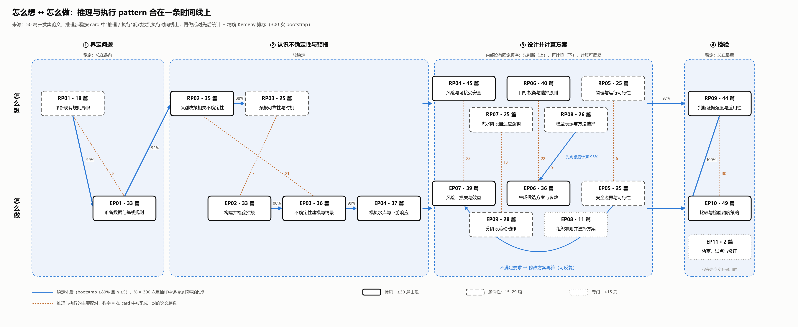
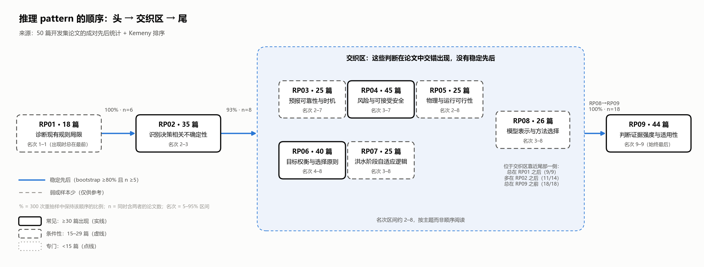
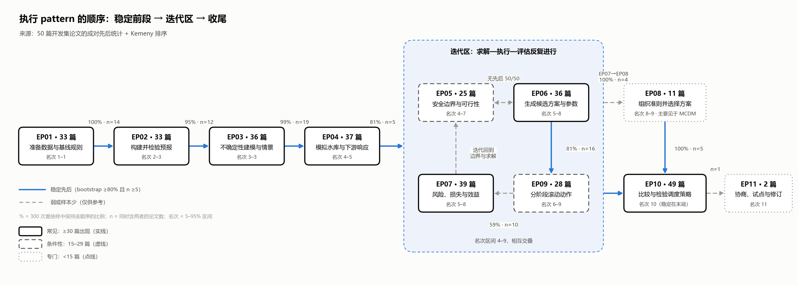

# 大 pattern 的排列顺序

日期：2026-10-28 | 数据：`../03-step-coding/step-coding.csv`（primary 编码）、`../../01-corpus/development-50/cards/`（第 4 节的推理 / 执行配对）

## 1. 合并顺序：推理与执行在一条时间线上



英文版：[`combined-order-en.png`](combined-order-en.png)。

### 方法（`combined_order_analysis.py`）

pattern 的先后不凭直觉决定，而是看它们在 50 篇论文中实际出现的先后。

1. **放到同一条时间线上。** 每张 card 第 4 节（功能抽象）把推理步骤和它支撑的执行步骤配成一对，例如"R3 / E4""R4 / E5–E6"。50 张 card 共 296 行这样的配对，覆盖 93% 的推理步骤和 94% 的执行步骤。
   - 执行步骤 Ek 放在位置 k；
   - 配对过的推理步骤放在它配对的第一个执行步骤之前（位置 = min(k) − 0.5）；
   - 没有配对的推理步骤按推理顺序，在前后两个已配对的推理步骤之间线性插值。
2. **定位：** 每个 pattern 在每篇论文中的位置，取它的 primary 步骤的平均位置。
3. **成对先后：** 只统计同时包含 A、B 的论文，计算 P(A 在 B 之前)。
4. **Kemeny 排序：** 求与所有成对关系冲突最少的总顺序。20 个 pattern 用按子集大小分层的动态规划求精确解，结果已与穷举法核对。
5. **Bootstrap 稳定性：** 对论文重抽样 300 次（seed 1），记录每个 pattern 名次的 5%–95% 区间，以及相邻两个 pattern 保持当前顺序的比例。
6. **判读：** bootstrap 中保持顺序的比例 ≥80%，且同时含两者的论文 n ≥5，视为稳定先后；达不到的视为没有固定先后。

原始结果：`combined-order-results.md`；推理与执行的配对计数：`rp-ep-pairing.csv`。

### 结果：四段

| 段 | 内容（一致顺序） | 稳定性 |
|---|---|---|
| ① 界定问题 | RP01 诊断现有规则 → EP01 数据与基线 | 99% |
| ② 认识不确定性与预报 | RP02 → RP03 → EP02 → EP03 → EP04 | 相邻对 65%–99%，多数 ≥88% |
| ③ 设计并计算方案 | 先判断：RP05、RP04、RP07、RP06、RP08；再计算：EP06、EP05、EP09、EP07、EP08 | 两组内部都没有稳定先后（约 50%）；"先判断后计算"稳定（RP08 → EP06，95%）；计算部分可反复 |
| ④ 检验 | RP09 判断证据 → EP10 比较与检验 | 97%–100% |

EP11（协商、试点与修订）只有 2 篇论文，名次区间 1–17，位置不可靠，图中放在检验之后，作为走向实际采用时的可选环节。

### 推理与执行的配对

每个推理 pattern 主要配对的执行 pattern（论文篇数）：RP01–EP01（8）、RP02–EP03（21）、RP03–EP02（7）、RP04–EP07（23）、RP05–EP05 / EP06（各 6）、RP06–EP06（22）、RP07–EP09（13）、RP08–EP06（9）、RP09–EP10（30）。

其中 RP06（目标权衡）主要与 EP06（生成方案）配对，而不是 taxonomy 中写的 EP08（选择方案，6 篇）：权衡主要体现在建模求解时设定目标和约束。

### 节点边框

方框中的篇数是该 pattern 在 50 篇开发集论文中出现的篇数（primary 或 secondary 匹配均计入，见 `../03-step-coding/pattern-coverage.csv`）。边框表示常见程度，阈值在看到结果之前已经设定：实线 ≥30 篇（常见），虚线 15–29 篇（条件性），点线 <15 篇（专门）。

## 2. 分层顺序（推理、执行各自排序）





英文版：[`reasoning-order-en.png`](reasoning-order-en.png)、[`execution-order-en.png`](execution-order-en.png)。

这两张图用同样的成对先后统计、精确 Kemeny 排序和 300 次 bootstrap，只是在推理层、执行层内部分别排序，不需要推理 / 执行配对。结论与合并顺序一致：推理为"头（RP01、RP02）→ 交织区（RP03–RP08）→ 尾（RP09）"，执行为"稳定前段（EP01–EP04）→ 迭代区（EP05、EP06、EP09、EP07）→ 收尾（EP08、EP10、EP11）"。执行层展示顺序中 EP09 排在 EP07 之前，但证据较弱，编号不变。

## 3. 局限

- 论文中的步骤顺序反映的是写作和抽取的顺序，不一定等于研究者实际的思考顺序。
- 推理步骤在合并时间线上的位置由配对推得；"放在配对的第一个执行步骤之前"是一条假设，会让推理 pattern 略微靠前。
- 多数成对比较只基于 5–20 篇同时包含两者的论文。
- RP08 只有 primary 证据（38 步），与其他步骤的 secondary 关系没有编码。

## 4. 复现

```
python combined_order_analysis.py      # 约 10 分钟：1 次精确排序 + 300 次 bootstrap
python draw_combined_order.py          # 中文图
python draw_combined_order.py --en     # 英文图
```
