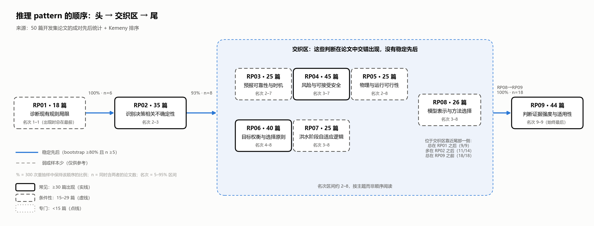
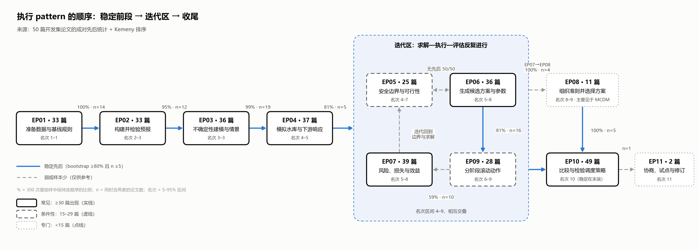

# Reservoir Flood-Operation Reasoning and Execution Pattern Taxonomy (final, English)

Date: 2026-10-01 | Status: **final (confirmed by the user on 2026-10-01; fixed input for skill construction)** | Counts taken from the small-pattern files. Chinese version: [`pattern-taxonomy-zh.md`](pattern-taxonomy-zh.md).

## 1. Version and evidence scope

- **Structure:** 9 reasoning patterns (RP) and 11 execution patterns (EP), with 104 small patterns (trigger families).
- **Evidence:** development corpus E01–E50: 760 extracted steps and 1,074 positive step-pattern matches (see `../03-step-coding/`). Step coding was done by Claude Code.
- **Held-out note:** V01–V05 contributed no evidence, but their coverage-check results (including uncovered and partially covered steps) were seen before this taxonomy was finalized. They must therefore be treated as **exposed**; independent validation requires new papers.

## 2. Overview

### Reasoning patterns (RP)

| ID | Name | Position | Frequency | Small patterns | Structure | Counterpart |
|---|---|---|---|---:|---|---|
| [RP01](../05-small-patterns/reasoning/RP01-families.md) | Diagnose limitations of existing operating rules | Head (always first when present) | Conditional: 18 papers | 4 | Additive | EP01-C (encode the current rule as an executable baseline) |
| [RP02](../05-small-patterns/reasoning/RP02-families.md) | Identify decision-relevant uncertainty | Head (second, fairly stable) | Common: 35 papers | 8 | Additive | EP03 (uncertainty modeling), EP02-C |
| [RP03](../05-small-patterns/reasoning/RP03-families.md) | Judge forecast reliability and timing | Interleaved zone | Conditional: 25 papers | 7 | Additive | EP02 (build and verify forecasts), EP10-C |
| [RP04](../05-small-patterns/reasoning/RP04-families.md) | Define flood risk and acceptable safety | Interleaved zone | Common: 45 papers | 7 | Additive | EP07 (calculate risk), EP05-B |
| [RP05](../05-small-patterns/reasoning/RP05-families.md) | Judge physical and operational feasibility | Interleaved zone | Conditional: 25 papers | 5 | Additive | EP05 (safety bounds and feasibility checks) |
| [RP06](../05-small-patterns/reasoning/RP06-families.md) | Frame trade-offs and selection principles | Interleaved zone | Common: 40 papers | 6 | Mixed | EP08 (select alternatives), EP06-B |
| [RP07](../05-small-patterns/reasoning/RP07-families.md) | Define adaptive logic across the flood event | Interleaved zone | Conditional: 25 papers | 6 | Additive | EP09 (staged rolling execution), EP06-C |
| [RP08](../05-small-patterns/reasoning/RP08-families.md) | Select model representation and solution methods | Interleaved zone, near the tail | Conditional: 26 papers | 6 | Select one per modeling component | Method implementations in EP02-A, EP03, EP04, EP06, EP08 |
| [RP09](../05-small-patterns/reasoning/RP09-families.md) | Judge evidence strength and applicability | Tail (always last) | Common: 44 papers | 5 | Additive | EP10 (compare and test) |

### Execution patterns (EP, display order)

| ID | Name | Position | Frequency | Small patterns | Structure | Counterpart |
|---|---|---|---|---:|---|---|
| [EP01](../05-small-patterns/execution/EP01-families.md) | Prepare data and baseline rules | Stable front (step 1) | Common: 33 papers | 4 | Additive | RP01, RP09-A |
| [EP02](../05-small-patterns/execution/EP02-families.md) | Build and verify forecasts | Stable front (step 2) | Common: 33 papers | 4 | Additive | RP03 |
| [EP03](../05-small-patterns/execution/EP03-families.md) | Model uncertainty and generate scenarios | Stable front (step 3) | Common: 36 papers | 7 | Mixed | RP02 |
| [EP04](../05-small-patterns/execution/EP04-families.md) | Simulate reservoir and downstream responses | Stable front (step 4) | Common: 37 papers | 4 | Mixed | RP05, RP08-A |
| [EP05](../05-small-patterns/execution/EP05-families.md) | Calculate safety bounds and check feasibility | Iterative block | Conditional: 25 papers | 4 | Additive | RP05, RP04-E |
| [EP06](../05-small-patterns/execution/EP06-families.md) | Generate candidate plans and rule parameters | Iterative block | Common: 36 papers | 5 | Select one | RP06, RP07, RP08-B/C |
| [EP09](../05-small-patterns/execution/EP09-families.md) | Translate plans into staged, rolling actions | Iterative block (placed before EP07; weak evidence) | Conditional: 28 papers | 4 | Additive | RP07 |
| [EP07](../05-small-patterns/execution/EP07-families.md) | Calculate risks, losses, and benefits | Iterative block | Common: 39 papers | 5 | Additive | RP04 |
| [EP08](../05-small-patterns/execution/EP08-families.md) | Organize criteria and select alternatives | Closing (mainly in multi-criteria decision papers) | Specialized: 11 papers | 4 | Additive | RP06-D/E |
| [EP10](../05-small-patterns/execution/EP10-families.md) | Compare and test operating policies | Closing (stable at the end) | Common: 49 papers | 6 | Additive | RP09 |
| [EP11](../05-small-patterns/execution/EP11-families.md) | Consult, pilot, and revise rules | Closing (evidence from 2 papers only) | Specialized: 2 papers | 3 | Additive | RP05-E, RP09-D |

**Structure types:**
- **Additive:** small patterns can apply together. The agent checks each one, applies those that fit, and states why the others do not.
- **Select one:** small patterns are alternative routes; usually one is chosen. The agent explains why it chose this route and not the others.
- **Mixed:** some small patterns are additive and others are alternatives; see each pattern.

**Frequency** uses the pre-specified tiers (>=30 / 15-29 / <15 papers). "Common" does not mean "necessary"; it only reflects frequency in this corpus.

## 3. Ordering

Method and results: [`../04-ordering/pattern-ordering.md`](../04-ordering/pattern-ordering.md) (pairwise precedence, Kemeny ranking, 300 bootstrap resamples). The diagrams are labeled in Chinese.

- **Reasoning: head → interleaved zone → tail.** RP01 and RP02 come first and RP09 is always last; RP03–RP08 interleave without a stable order and should be presented by theme.
- **Execution: stable front → iterative block → closing.** EP01 → EP02 → EP03 → EP04 is stable; EP05, EP06, EP09, and EP07 often iterate; EP08 → EP10 → EP11 close the sequence.
- The order is for presentation and skill orchestration only; it is not a workflow every paper follows.

## 4. Reasoning patterns

### RP01 Diagnose limitations of existing operating rules

**Core question:** Under what conditions does an existing reservoir operating rule fail to balance flood risk with other objectives, and which limitations indicate that it needs adjustment?

**Evidence:** 19 steps, 18 papers, conditional | **Position:** Head (always first when present) | **Structure:** Additive (Several limitations can coexist; usually one is the main cause)

| Small pattern | Description | Steps | Papers | Strength |
|---|---|---:|---:|---|
| **RP01-A** Fixed flood-control allocation causes a safety-benefit imbalance | A fixed flood-limited level, guide curve, or flood pool wastes water in small floods or under-protects in large floods | 10 | 10 | Established |
| **RP01-B** The rule cannot use available forecasts or their uncertainty | Forecasts exist, but the rule uses only the current state, treats forecasts as certain, or relies on a horizon that is too short | 4 | 4 | Established |
| **RP01-C** The rule boundary omits system objects | The rule covers only one reservoir and ignores cascade coupling or downstream control points | 2 | 2 | Provisional |
| **RP01-D** The basis of the rule is outdated or too narrow | The manual is decades old, the flood regime is assumed stationary, or parameters were calibrated on a few events | 3 | 3 | Established (at threshold) |

Counterpart: EP01-C (encode the current rule as an executable baseline). Full definitions, representative evidence, and decision rules (in Chinese): [`RP01-families.md`](../05-small-patterns/reasoning/RP01-families.md).

### RP02 Identify decision-relevant uncertainty

**Core question:** Which uncertainties can change releases, storage, risk, or rule selection and therefore must be represented?

**Evidence:** 73 steps, 35 papers, common | **Position:** Head (second, fairly stable) | **Structure:** Additive (Check all 8 small patterns)

| Small pattern | Description | Steps | Papers | Strength |
|---|---|---:|---:|---|
| **RP02-A** Forecast uncertainty must enter the decision | Decisions rely on forecasts; treating them as certain causes over- or under-preparation | 12 | 10 | Established |
| **RP02-B** Uncertainty does not come only from forecasts | Initial level, hydrograph shape, discharge capacity, storage curves, and wind also change outcomes | 9 | 8 | Established |
| **RP02-C** Keep only decision-relevant sources and state exclusions | Too many sources exist; screen by importance and tractability and state what was excluded | 4 | 3 | Established |
| **RP02-D** Error structure is not a single fixed distribution | Errors vary with lead time, flow, and season, or are non-normal, multimodal, or fuzzy | 15 | 10 | Established |
| **RP02-E** Errors are dependent | Errors correlate across times, sites, variables, or ensemble members; assuming independence understates joint risk | 15 | 14 | Established |
| **RP02-F** Derive a distribution from accuracy metrics or deterministic forecasts | With limited data, infer the error distribution from qualified rate, NSE, or a point forecast | 5 | 5 | Established |
| **RP02-G** Trace how uncertainty reaches levels, releases, and risk | State the propagation path, where it is amplified, and when new information resolves it | 9 | 9 | Established |
| **RP02-H** The size of uncertainty changes the optimal decision | A threshold exists beyond which the optimal storage or release strategy switches | 4 | 3 | Established |

Counterpart: EP03 (uncertainty modeling), EP02-C. Full definitions, representative evidence, and decision rules (in Chinese): [`RP02-families.md`](../05-small-patterns/reasoning/RP02-families.md).

### RP03 Judge forecast reliability and timing

**Core question:** Which forecast horizons and flood stages can support which operating actions?

**Evidence:** 41 steps, 25 papers, conditional | **Position:** Interleaved zone | **Structure:** Additive

| Small pattern | Description | Steps | Papers | Strength |
|---|---|---:|---:|---|
| **RP03-A** Reliability varies with lead time; use forecasts by stage | Near-term forecasts are accurate and long-lead ones coarse; different lead times support different actions | 7 | 7 | Established |
| **RP03-B** Forecasts must arrive early enough, with the right indicator | The lead time must cover the time needed to draw down; choose variables that signal floods earlier | 9 | 8 | Established |
| **RP03-C** Verify forecast quality before use | Whether the forecast meets requirements is a precondition for using it | 7 | 6 | Established |
| **RP03-D** Forecast accuracy is not operational value | High skill does not guarantee better operation; bound the value with no-forecast and perfect-forecast references | 5 | 5 | Established |
| **RP03-E** Derive the required forecast accuracy from acceptable risk | Beyond some error the forecast stops being useful; or a risk target implies a minimum accuracy | 6 | 5 | Established |
| **RP03-F** Beyond the forecast horizon and unequal horizons across reservoirs | Risk continues after the lead time; upstream and downstream reservoirs have different lead times | 3 | 2 | Provisional |
| **RP03-G** How to use a forecast that may be wrong | Choose a conservative quantile, correct when wrong, or fall back to measurement-based rules | 4 | 4 | Established |

Counterpart: EP02 (build and verify forecasts), EP10-C. Full definitions, representative evidence, and decision rules (in Chinese): [`RP03-families.md`](../05-small-patterns/reasoning/RP03-families.md).

### RP04 Define flood risk and acceptable safety

**Core question:** What counts as unsafe, which measures should quantify risk, and how much risk is acceptable?

**Evidence:** 79 steps, 45 papers, common | **Position:** Interleaved zone | **Structure:** Additive (A/B define events, C chooses measures, D/E set standards and derive bounds, F/G aggregate)

| Small pattern | Description | Steps | Papers | Strength |
|---|---|---:|---:|---|
| **RP04-A** Define reservoir-side failure events | Define unsafe as maximum level or required flood pool exceeding a safety threshold | 16 | 13 | Established |
| **RP04-B** Define downstream and engineering consequences | Levee failure, release above safe channel capacity, dam-break losses, shortage and lost generation | 10 | 9 | Established |
| **RP04-C** One exceedance probability is not enough; add other measures | Add loss, tail (CVaR), entropy, duration, or resilience | 10 | 7 | Established |
| **RP04-D** Set an acceptable-risk benchmark | Use current-rule risk, design or protection standards, or a stationary benchmark as the pass line | 11 | 11 | Established |
| **RP04-E** Derive operating bounds from acceptable risk | Convert the risk limit into a safety margin, level ceiling, or the inflow quantile that must be accommodated | 13 | 11 | Established |
| **RP04-F** Several safety objects or thresholds at once | Dam versus downstream, multiple reservoirs, or several thresholds interact and need an explicit combination rule | 10 | 7 | Established |
| **RP04-G** Aggregate risk over time | Distinguish point and whole-process risk, within and beyond the lead time, and weight by flood occurrence probability | 9 | 8 | Established |

Counterpart: EP07 (calculate risk), EP05-B. Full definitions, representative evidence, and decision rules (in Chinese): [`RP04-families.md`](../05-small-patterns/reasoning/RP04-families.md).

### RP05 Judge physical and operational feasibility

**Core question:** Can the proposed prerelease, target level, or release adjustment actually be carried out in time, space, facilities, and institutions?

**Evidence:** 40 steps, 25 papers, conditional | **Position:** Interleaved zone | **Structure:** Additive

| Small pattern | Description | Steps | Papers | Strength |
|---|---|---:|---:|---|
| **RP05-A** Hard limits of facilities and operation | Level, storage, outlet capacity, release change, and ramping limits exclude impossible actions | 8 | 8 | Established |
| **RP05-B** Is there enough time | Can drawdown or prerelease finish within the lead time; longer lead time permits a higher ceiling | 8 | 7 | Established |
| **RP05-C** Is there enough storage space | Can remaining storage absorb the design flood, and can released water be refilled | 9 | 8 | Established |
| **RP05-D** Downstream and system conditions limit local action | Travel time, channel storage, and uncontrolled local inflow mean locally feasible is not system-feasible | 5 | 2 | Provisional |
| **RP05-E** Model feasibility is not implementability | Regulations, authority, standard tools, data, computing time, and departmental approval | 10 | 6 | Established |

Counterpart: EP05 (safety bounds and feasibility checks). Full definitions, representative evidence, and decision rules (in Chinese): [`RP05-families.md`](../05-small-patterns/reasoning/RP05-families.md).

### RP06 Frame trade-offs and selection principles

**Core question:** When flood safety, supply, storage, and hydropower cannot all be optimized, what principle governs the choice?

**Evidence:** 84 steps, 40 papers, common | **Position:** Interleaved zone | **Structure:** Mixed (A and F always apply; C (safety first) and D/E (noninferior set plus preferences) are two selection principles that may be combined)

| Small pattern | Description | Steps | Papers | Strength |
|---|---|---:|---:|---|
| **RP06-A** Identify conflicting objectives | Safety and benefits trade against each other, or dam safety trades against downstream safety | 21 | 21 | Established |
| **RP06-B** Allocate limited resources over time or across the system | Store now or keep for later; upstream reservoirs take over downstream tasks | 13 | 7 | Established |
| **RP06-C** Safety first: define the safe domain, then optimize benefits | Safety is a non-compensable constraint; benefits are pursued only once it is met | 14 | 11 | Established |
| **RP06-D** No single optimum: keep a noninferior set | Do not collapse to one score too early; aggregate only when objectives are commensurable | 11 | 7 | Established |
| **RP06-E** The final choice depends on preferences and ranking rules | Weights, TOPSIS, fuzzy optimum, or multi-agency consultation, made transparent and testable | 15 | 11 | Established |
| **RP06-F** Formulate objectives to fit the problem | Flood scale, site purpose, and operating stage decide what the objective function contains | 10 | 9 | Established |

Counterpart: EP08 (select alternatives), EP06-B. Full definitions, representative evidence, and decision rules (in Chinese): [`RP06-families.md`](../05-small-patterns/reasoning/RP06-families.md).

### RP07 Define adaptive logic across the flood event

**Core question:** As a flood develops, when should an action be started, changed, suspended, or reversed?

**Evidence:** 40 steps, 25 papers, conditional | **Position:** Interleaved zone | **Structure:** Additive (C (how often to recompute) and D (decision-sharing structure) often appear together)

| Small pattern | Description | Steps | Papers | Strength |
|---|---|---:|---:|---|
| **RP07-A** Different flood stages need different actions | Prerelease, rising-limb detention, peak, recession, and refill each follow their own rules | 8 | 6 | Established |
| **RP07-B** Switch actions by thresholds | When a forecast value, risk, or available water crosses a threshold, switch to another branch | 10 | 9 | Established |
| **RP07-C** Rolling update: execute only the next step | Plan over the whole horizon, execute only the current period, and recompute when new information arrives | 9 | 9 | Established |
| **RP07-D** Share current decisions; let future decisions branch with information | Two-stage or scenario-tree structure: one action until uncertainty resolves, then branch | 7 | 6 | Established |
| **RP07-E** Correction and fallback when the forecast is wrong | Correct by error sign, adjust gradually, or fall back to measurement-based rules | 3 | 2 | Provisional |
| **RP07-F** Seasonal staging and multi-year adjustment | Split the flood season into stages, or adjust bounds period by period under nonstationarity | 3 | 3 | Established (at threshold) |

Counterpart: EP09 (staged rolling execution), EP06-C. Full definitions, representative evidence, and decision rules (in Chinese): [`RP07-families.md`](../05-small-patterns/reasoning/RP07-families.md).

### RP08 Select model representation and solution methods

**Core question:** How should the operating problem be turned into a model that is computable and credible enough, and which representation and method are chosen for what reason?

**Evidence:** 38 steps, 26 papers, conditional | **Position:** Interleaved zone, near the tail | **Structure:** Select one per modeling component (For each modeling component (system representation, solution, uncertainty computation, ...) choose one method and justify it; A is reservoir-specific, B-F are general methods)

| Small pattern | Label | Description | Steps | Papers | Strength |
|---|---|---|---:|---:|---|
| **RP08-A** Reservoir system representation and computational trade-offs | Reservoir-specific | Reservoir aggregation, channel storage, local linearization, routing-model fidelity, scenario-tree size, compact rules | 11 | 10 | Established |
| **RP08-B** Analytical derivation route | General method | Derive optimal rules via KKT or equal marginal utility and state when they hold | 5 | 5 | Established |
| **RP08-C** Choice of solution and search algorithm | General method | Genetic and evolutionary algorithms, global solvers, Monte Carlo search | 4 | 4 | Established |
| **RP08-D** Methods for computing uncertainty and risk | General method (applied to hydrology) | SDE, Bayesian networks, maximum-entropy densities, mixture distributions, continuous integration | 10 | 6 | Established |
| **RP08-E** Construction choices for data-driven forecast models | General method | Event clustering, MIC input selection, LSTM, model combination | 4 | 2 | Provisional |
| **RP08-F** Methods for handling evaluation criteria | General method | Network weights, sensitivity, PCA, entropy weights | 4 | 2 | Provisional |

Counterpart: Method implementations in EP02-A, EP03, EP04, EP06, EP08. Full definitions, representative evidence, and decision rules (in Chinese): [`RP08-families.md`](../05-small-patterns/reasoning/RP08-families.md).

### RP09 Judge evidence strength and applicability

**Core question:** What does the evidence establish, under which conditions, and where does the claim stop?

**Evidence:** 87 steps, 44 papers, common | **Position:** Tail (always last) | **Structure:** Additive

| Small pattern | Description | Steps | Papers | Strength |
|---|---|---:|---:|---|
| **RP09-A** Improvement must be compared with the right baseline | Use current rule, no-forecast, and perfect-forecast comparators to isolate the true contribution | 18 | 15 | Established |
| **RP09-B** Robustness: sensitivity, stress, and holdout tests | Does the result depend on one flood, one parameter set, one record, or the number of scenarios | 22 | 18 | Established |
| **RP09-C** Data and models must be credible first | Check synthetic forecasts, error models, and risk estimators before use | 16 | 13 | Established |
| **RP09-D** Applicability depends on site, event, and institutions | Results from one reservoir, period, or basin do not transfer automatically | 21 | 18 | Established |
| **RP09-E** Explain why the result occurs | Attribute improvements or failures to specific mechanisms rather than only reporting numbers | 10 | 10 | Established |

Counterpart: EP10 (compare and test). Full definitions, representative evidence, and decision rules (in Chinese): [`RP09-families.md`](../05-small-patterns/reasoning/RP09-families.md).

## 5. Execution patterns

### EP01 Prepare data and baseline rules

**Core task:** Before modeling or comparison, how should a reproducible and fair case baseline be established?

**Evidence:** 38 steps, 33 papers, common | **Position:** Stable front (step 1) | **Structure:** Additive

| Small pattern | Description | Steps | Papers | Strength |
|---|---|---:|---:|---|
| **EP01-A** Assemble hydrologic, forecast, and operating data | Collect inflow, rainfall, forecast hindcasts, and operating records, aligned in time and space | 8 | 8 | Established |
| **EP01-B** Describe the physical system and safety thresholds | Storage curves, discharge capacity, characteristic levels, downstream control points, multi-reservoir links | 11 | 11 | Established |
| **EP01-C** Encode current or tested rules in executable form | The current rule as comparator, or the forecast rule under test as explicit parameters | 8 | 8 | Established |
| **EP01-D** Set initial state, events, and experiment boundaries | Initial level, design floods, time window, lead time, and deliberate simplifying assumptions | 11 | 11 | Established |

Counterpart: RP01, RP09-A. Full definitions, representative evidence, and decision rules (in Chinese): [`EP01-families.md`](../05-small-patterns/execution/EP01-families.md).

### EP02 Build and verify forecasts

**Core task:** How should inflow or flood forecasts be produced for reservoir decisions, and how should their reliability be demonstrated?

**Evidence:** 50 steps, 33 papers, common | **Position:** Stable front (step 2) | **Structure:** Additive (A/B only when the study builds its own forecast; C/D whenever forecasts are used)

| Small pattern | Description | Steps | Papers | Strength |
|---|---|---:|---:|---|
| **EP02-A** Build or train a forecast model | Hydrologic or data-driven models, probabilistic forecasts, or precursor indicators | 14 | 12 | Established |
| **EP02-B** Prepare and correct forecast inputs | Bias correction, downscaling, assimilation, naturalized flows, assembling hindcasts | 6 | 6 | Established |
| **EP02-C** Quantify forecast error and skill by lead time | Compare historical forecasts with observations to get error samples, qualified rate, reliable horizon | 17 | 17 | Established |
| **EP02-D** Verify operational usability of forecasts | Coverage, extremes, comparison with reference forecasts, site monitoring capability | 13 | 11 | Established |

Counterpart: RP03. Full definitions, representative evidence, and decision rules (in Chinese): [`EP02-families.md`](../05-small-patterns/execution/EP02-families.md).

### EP03 Model uncertainty and generate scenarios

**Core task:** How should decision-relevant uncertainty be converted into scenarios usable for simulation and optimization?

**Evidence:** 85 steps, 36 papers, common | **Position:** Stable front (step 3) | **Structure:** Mixed (A, B, F, G are additive; C (forecast scenarios) / D (design floods) / E (scenario trees) are chosen as needed)

| Small pattern | Description | Steps | Papers | Strength |
|---|---|---:|---:|---|
| **EP03-A** Specify or fit error and variable distributions | Normal, maximum-entropy, mixture, fuzzy membership, seasonal fitting, or derived from accuracy metrics | 28 | 21 | Established |
| **EP03-B** Preserve dependence when generating | Copulas, VAR, Schaake shuffle, generation conditional on the previous day | 11 | 7 | Established |
| **EP03-C** Generate forecast scenarios and ensembles | Monte Carlo perturbation, LHS, MMFE, synthetic ensembles, quantile paths | 20 | 16 | Established |
| **EP03-D** Generate or scale design floods and stochastic flood events | Floods beyond the historical range for stress testing and risk estimation | 8 | 7 | Established |
| **EP03-E** Reduce ensembles to scenario trees | Keep representative branches so current decisions are shared | 3 | 3 | Established (at threshold) |
| **EP03-F** Write non-forecast uncertainty into the water balance | Initial storage, discharge coefficient, storage curve, wind; stochastic-differential state | 9 | 7 | Established |
| **EP03-G** Check that generated scenarios are faithful | Statistics, coverage, dependence structure, extreme-event attributes | 6 | 4 | Established |

Counterpart: RP02. Full definitions, representative evidence, and decision rules (in Chinese): [`EP03-families.md`](../05-small-patterns/execution/EP03-families.md).

### EP04 Simulate reservoir and downstream responses

**Core task:** How should inflow scenarios and operating actions be converted into levels, storage, flows, and downstream consequences?

**Evidence:** 59 steps, 37 papers, common | **Position:** Stable front (step 4) | **Structure:** Mixed (A always; B depends on the system; C if inputs are uncertain; D replaces A (full simulation or surrogate))

| Small pattern | Description | Steps | Papers | Strength |
|---|---|---:|---:|---|
| **EP04-A** Build a reservoir water-balance simulator and compute trajectories | Advance storage, level, and release per period for single or cascade reservoirs; check against history when possible | 21 | 19 | Established |
| **EP04-B** Simulate basin, channel, and downstream processes | Channel routing, local inflow, naturalized flow, channel storage, downstream station levels | 6 | 5 | Established |
| **EP04-C** Propagate uncertainty to levels and flows | Route many scenarios, SDEs, or moment recursions; collect maxima and other outputs | 20 | 13 | Established |
| **EP04-D** Replace full simulation with surrogate or probabilistic models | Bayesian networks, simplified state-space models, precomputed risk relationships | 12 | 4 | Established (at threshold) |

Counterpart: RP05, RP08-A. Full definitions, representative evidence, and decision rules (in Chinese): [`EP04-families.md`](../05-small-patterns/execution/EP04-families.md).

### EP05 Calculate safety bounds and check feasibility

**Core task:** How should safety, physical, and operating requirements become explicit checks on candidate actions?

**Evidence:** 40 steps, 25 papers, conditional | **Position:** Iterative block | **Structure:** Additive (C is often embedded in EP06 optimization constraints)

| Small pattern | Description | Steps | Papers | Strength |
|---|---|---:|---:|---|
| **EP05-A** Calculate feasible level or storage ceilings | From release capacity, lead time, and refill, compute how high the level can be raised | 11 | 9 | Established |
| **EP05-B** Derive bounds from risk or safety requirements and screen | Convert acceptable risk into release intervals or margins, then check each candidate | 11 | 8 | Established |
| **EP05-C** Impose facility constraints in simulation or optimization | Release, change, storage, and ramping limits; handle candidates that violate them | 16 | 14 | Established |
| **EP05-D** Check implementation readiness | Are monitoring, data, and tools sufficient to support operation | 2 | 1 | Singleton |

Counterpart: RP05, RP04-E. Full definitions, representative evidence, and decision rules (in Chinese): [`EP05-families.md`](../05-small-patterns/execution/EP05-families.md).

### EP06 Generate candidate plans and rule parameters

**Core task:** How should objectives, constraints, and scenarios become release schedules, target levels, or rule parameters?

**Evidence:** 66 steps, 36 papers, common | **Position:** Iterative block | **Structure:** Select one (A (analytical rules) / B (deterministic optimization) / C (scenario optimization or MPC) / D (parameter calibration) are alternative solution routes; E (enumerating alternatives) may be added)

| Small pattern | Description | Steps | Papers | Strength |
|---|---|---:|---:|---|
| **EP06-A** Derive analytical or piecewise rules | Use KKT, equal marginal utility, or heuristic steps to obtain piecewise hedging rules directly | 18 | 7 | Established |
| **EP06-B** Formulate and solve deterministic or multiobjective optimization | Write objectives and constraints, solve with GA, NSGA, MILP, etc., to obtain schedules or noninferior sets | 17 | 10 | Established |
| **EP06-C** Scenario-based stochastic optimization and rolling MPC | Optimize expected objectives over scenarios or trees; MPC re-optimizes each step | 13 | 11 | Established |
| **EP06-D** Search or calibrate rule parameters | With the rule form fixed, search or calibrate thresholds, coefficients, and boundary levels | 14 | 10 | Established |
| **EP06-E** Enumerate structurally different alternatives | Keep several structurally different plans for later evaluation and selection | 4 | 4 | Established |

Counterpart: RP06, RP07, RP08-B/C. Full definitions, representative evidence, and decision rules (in Chinese): [`EP06-families.md`](../05-small-patterns/execution/EP06-families.md).

### EP09 Translate plans into staged, rolling actions

**Core task:** How should a technical plan become release or level instructions that can be executed now and updated later?

**Evidence:** 45 steps, 28 papers, conditional | **Position:** Iterative block (placed before EP07; weak evidence) | **Structure:** Additive

| Small pattern | Description | Steps | Papers | Strength |
|---|---|---:|---:|---|
| **EP09-A** Convert plan results into the current release | From target storage, safety margins, or member schedules, compute this period's release | 6 | 6 | Established |
| **EP09-B** Execute staged or branching rules | Prerelease, normal, peak, recession, and refill branches switched by thresholds | 22 | 15 | Established |
| **EP09-C** Rolling update and closed-loop recomputation | Execute only the first step, update state and forecast, recompute; correct when forecast bias is detected | 12 | 12 | Established |
| **EP09-D** Multi-reservoir and multi-agency coordination and emergency branches | Cascade peak staggering, power and navigation coordination, emergency plans for failures or extreme floods | 5 | 2 | Provisional |

Counterpart: RP07. Full definitions, representative evidence, and decision rules (in Chinese): [`EP09-families.md`](../05-small-patterns/execution/EP09-families.md).

### EP07 Calculate risks, losses, and benefits

**Core task:** How should the safety consequences and other benefits of each candidate plan be quantified consistently?

**Evidence:** 68 steps, 39 papers, common | **Position:** Iterative block | **Structure:** Additive

| Small pattern | Description | Steps | Papers | Strength |
|---|---|---:|---:|---|
| **EP07-A** Calculate threshold-exceedance risk | Count or integrate the probability that maximum level, release, or required flood pool exceeds a threshold | 24 | 18 | Established |
| **EP07-B** Calculate losses, tail, and composite risk | Expected loss, CVaR, entropy, duration, loss ratios | 11 | 9 | Established |
| **EP07-C** Calculate benefits and non-safety indicators | Storage, refill rate, generation, spill, curtailment, downstream flow frequency | 11 | 11 | Established |
| **EP07-D** Combine risk across objects and hazards | Union/intersection of thresholds, weighted multi-reservoir aggregation, criteria matrices | 9 | 6 | Established |
| **EP07-E** Combine risk across time and stages | Within and beyond the lead time, point versus whole process, weighted by flood occurrence probability | 13 | 10 | Established |

Counterpart: RP04. Full definitions, representative evidence, and decision rules (in Chinese): [`EP07-families.md`](../05-small-patterns/execution/EP07-families.md).

### EP08 Organize criteria and select alternatives

**Core task:** When feasible alternatives have no single optimum, how should a transparent choice be made?

**Evidence:** 25 steps, 11 papers, specialized | **Position:** Closing (mainly in multi-criteria decision papers) | **Structure:** Additive (A then B/C; D optional)

| Small pattern | Description | Steps | Papers | Strength |
|---|---|---:|---:|---|
| **EP08-A** Build the criteria system and decision matrix | List criteria and directions; screen, decorrelate, and weight criteria when needed | 10 | 4 | Established (at threshold) |
| **EP08-B** Rank and test ranking stability | Check whether rankings change with weights, methods, flood types, or deleted criteria | 5 | 4 | Established (at threshold) |
| **EP08-C** Select a compromise from the noninferior set | Use TOPSIS, fuzzy optimum, or minimum composite risk to choose one plan | 8 | 7 | Established |
| **EP08-D** Staged screening and multi-agency consultation | Coarse screening before detailed evaluation; final scheme decided by consultation | 2 | 2 | Provisional |

Counterpart: RP06-D/E. Full definitions, representative evidence, and decision rules (in Chinese): [`EP08-families.md`](../05-small-patterns/execution/EP08-families.md).

### EP10 Compare and test operating policies

**Core task:** How should an adjustment be compared with a suitable baseline and tested without introducing unacceptable failure modes?

**Evidence:** 90 steps, 49 papers, common | **Position:** Closing (stable at the end) | **Structure:** Additive

| Small pattern | Description | Steps | Papers | Strength |
|---|---|---:|---:|---|
| **EP10-A** Compare with baselines under identical conditions | Against the current rule, conventional operation, deterministic plans, or historical operation | 32 | 24 | Established |
| **EP10-B** Test with historical events and trajectories | Look beyond aggregates at typical events and simulator agreement with history | 7 | 7 | Established |
| **EP10-C** Compare information conditions | No forecast, deterministic, ensemble, synthetic, and perfect forecasts | 10 | 6 | Established |
| **EP10-D** Sensitivity, stress, and extreme tests | Parameters, error levels, scenario count, lead time, scaled floods | 26 | 22 | Established |
| **EP10-E** Holdout, transfer, and generalization tests | Leave-one-year-out, held-out events, cross-reservoir thresholds, random seeds | 7 | 4 | Established (at threshold) |
| **EP10-F** Verify the method itself | Use independent samples or another method to check risk estimates or evaluation results | 8 | 6 | Established |

Counterpart: RP09. Full definitions, representative evidence, and decision rules (in Chinese): [`EP10-families.md`](../05-small-patterns/execution/EP10-families.md).

### EP11 Consult, pilot, and revise rules

**Core task:** How should a technically feasible adjustment pass institutional review, pilot learning, and formal rule revision?

**Evidence:** 7 steps, 2 papers, specialized | **Position:** Closing (evidence from 2 papers only) | **Structure:** Additive (Proceed A then B then C)

| Small pattern | Description | Steps | Papers | Strength |
|---|---|---:|---:|---|
| **EP11-A** Organize cross-agency review and staged screening | Steering committee, workplan, staged viability assessment, rounds of consultation | 3 | 2 | Provisional |
| **EP11-B** Controlled pilot | Temporarily modify the operating manual and observe the effects | 1 | 1 | Singleton |
| **EP11-C** Disposition and rule revision | Defer, research, fully assess, or update the manual; review after the event and revise | 3 | 2 | Provisional |

Counterpart: RP05-E, RP09-D. Full definitions, representative evidence, and decision rules (in Chinese): [`EP11-families.md`](../05-small-patterns/execution/EP11-families.md).

## 6. Cross-pattern boundary rules

| Easily confused | Boundary |
|---|---|
| RP01 vs RP06 | RP01 diagnoses what is wrong with the current rule; RP06 decides how objectives are traded off, not necessarily about the current rule. |
| RP01 vs RP09 | RP01 diagnoses flaws in the operating rule; RP09 judges whether the research evidence is adequate (for example, a short hindcast belongs to RP09). |
| RP02 vs RP03 | RP02 identifies which uncertainties exist and their structure; RP03 judges whether a forecast at a lead time can support a specific action. |
| RP02 vs RP08 | RP02 judges how uncertainty affects and propagates through the decision; RP08 decides which method represents and computes it. |
| RP03 vs RP05 | RP03 judges how much lead time the forecast provides; RP05 judges whether the reservoir can complete the action within that time. |
| RP04 vs RP05 | RP04 bounds come from the risk limit; RP05 bounds come from physical capacity, time, and institutions. |
| RP06 vs EP08 | RP06 decides the selection principle; EP08 builds the criteria and performs the ranking. |
| RP07 vs EP09 | RP07 decides when and under which conditions to switch and recompute; EP09 turns this into release instructions. |
| RP08 vs RP09 | RP08 judges method suitability before results exist; RP09 judges what results support after testing. |
| RP09 vs EP10 | RP09 interprets what tests establish; EP10 performs comparison, stress, and holdout tests. |
| EP02 vs EP03 | EP02 builds and verifies the forecast product up to error samples; EP03 fits distributions to those samples and generates scenarios. |
| EP04 vs EP07 | EP04 produces trajectories or distributions of levels, storage, and flows; exceedance counting and risk or benefit calculation belong to EP07. |
| EP05 vs EP06 | EP05 computes bounds and screens; formulating and solving the constrained optimization belongs to EP06 (constraints may be EP05 secondary). |
| EP06-E vs EP08 | EP06-E only produces structurally different candidates; choosing among them belongs to EP08. |
| EP08-D vs EP11 | EP08-D concerns which plan is chosen; EP11 concerns how the plan passes institutional review, piloting, and rule revision. |

## 7. Integration decisions

1. RP08 takes all 38 method-choice steps, with small patterns tagged as reservoir-specific or general method; it sits at its empirical position, in the interleaved zone near the tail.
2. EP05 is not merged into EP06; EP02 and EP03 are not merged and are separated by the rules in Section 6.
3. The 12 provisional or singleton small patterns (mainly EP11, RP08-E/F, EP05-D, EP09-D, EP08-D, RP01-C, RP03-F, RP05-D, RP07-E) are kept as optional branches with their labels.
4. The execution display order places EP09 before EP07, for presentation and skill orchestration only; IDs are unchanged.
5. Independent second coding is deferred until after the skill prototype.

**Known limitations:**
- Large-pattern mapping and small-pattern grouping were done by one coder.
- RP08 has primary evidence only; its secondary relations are not yet coded.
- Evidence comes from structured extractions of papers and reflects the research process as reported; the corpus is dominated by modeling and simulation studies, with little practice evidence (EP11).

## 8. Traceability

- Large-pattern definitions: [`../02-large-patterns/large-patterns.md`](../02-large-patterns/large-patterns.md)
- Step coding and matches: [`../03-step-coding/`](../03-step-coding/)
- Ordering: [`../04-ordering/`](../04-ordering/)
- Small patterns and row-level assignments: [`../05-small-patterns/`](../05-small-patterns/)
