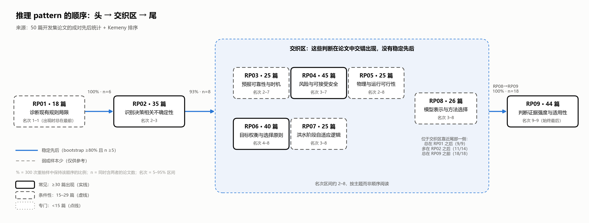
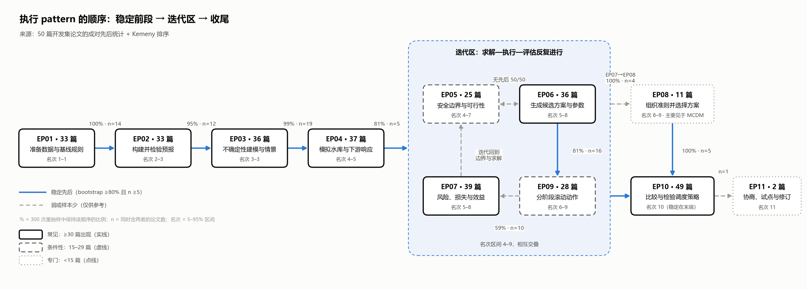

# 水库防洪调度推理与执行 pattern taxonomy（定稿，中文）

日期：2026-10-01 | 状态：**定稿（2026-10-01 用户确认；冻结后作为 skill 构建的固定输入）** | 小 pattern 表格从各 `-families.md` 汇总 | 英文版：[`pattern-taxonomy-en.md`](pattern-taxonomy-en.md)

## 1. 版本与证据范围

- **结构：** 9 个推理 pattern（RP）+ 11 个执行 pattern（EP），共 104 个小 pattern。
- **证据：** E01–E50 开发集，760 个抽取步骤，1,074 条正向匹配（见 `../03-step-coding/`）。步骤编码由 Claude Code 完成。
- **held-out 说明：** V01–V05 没有作为证据；但在本 taxonomy 定稿之前，V01–V05 的覆盖检查结果（包括未覆盖与部分覆盖的步骤）已经被看过。因此 V01–V05 应视为**已暴露**，不能作为独立验证集；独立验证需要另选新论文。

## 2. 总览

### 推理 pattern（RP）

| ID | 名称 | 位置 | 常见程度 | 小 pattern | 结构 | 对应 |
|---|---|---|---|---:|---|---|
| [RP01](../05-small-patterns/reasoning/RP01-families.md) | 诊断现有调度规则的局限 | 头（出现时总在最前） | 条件性（15–29 篇）：18 篇 | 4 | 叠加 | EP01-C（把现行规则写成可执行的基线） |
| [RP02](../05-small-patterns/reasoning/RP02-families.md) | 识别影响决策的不确定性 | 头（第二位，较稳定） | 常见（≥30 篇）：35 篇 | 8 | 叠加 | EP03（不确定性建模）、EP02-C |
| [RP03](../05-small-patterns/reasoning/RP03-families.md) | 判断预报的可靠性与时效 | 交织区 | 条件性（15–29 篇）：25 篇 | 7 | 叠加 | EP02（构建并检验预报）、EP10-C |
| [RP04](../05-small-patterns/reasoning/RP04-families.md) | 定义洪水风险与可接受的安全 | 交织区 | 常见（≥30 篇）：45 篇 | 7 | 叠加 | EP07（计算风险）、EP05-B |
| [RP05](../05-small-patterns/reasoning/RP05-families.md) | 判断物理与运行上的可行性 | 交织区 | 条件性（15–29 篇）：25 篇 | 5 | 叠加 | EP05（安全边界与可行性检查） |
| [RP06](../05-small-patterns/reasoning/RP06-families.md) | 权衡目标与选择原则 | 交织区 | 常见（≥30 篇）：40 篇 | 6 | 混合 | EP08（选择方案）、EP06-B |
| [RP07](../05-small-patterns/reasoning/RP07-families.md) | 随洪水过程自适应的调度逻辑 | 交织区 | 条件性（15–29 篇）：25 篇 | 6 | 叠加 | EP09（分阶段滚动执行）、EP06-C |
| [RP08](../05-small-patterns/reasoning/RP08-families.md) | 选择模型表示与求解方法 | 交织区，靠近尾部 | 条件性（15–29 篇）：26 篇 | 6 | 按建模环节分别择一 | EP02-A、EP03、EP04、EP06、EP08 的方法实现 |
| [RP09](../05-small-patterns/reasoning/RP09-families.md) | 判断证据强度与适用范围 | 尾（始终最后） | 常见（≥30 篇）：44 篇 | 5 | 叠加 | EP10（比较与检验） |

### 执行 pattern（EP，按展示顺序）

| ID | 名称 | 位置 | 常见程度 | 小 pattern | 结构 | 对应 |
|---|---|---|---|---:|---|---|
| [EP01](../05-small-patterns/execution/EP01-families.md) | 准备数据与基线规则 | 稳定前段（第 1 步） | 常见（≥30 篇）：33 篇 | 4 | 叠加 | RP01、RP09-A |
| [EP02](../05-small-patterns/execution/EP02-families.md) | 构建并检验预报 | 稳定前段（第 2 步） | 常见（≥30 篇）：33 篇 | 4 | 叠加 | RP03 |
| [EP03](../05-small-patterns/execution/EP03-families.md) | 不确定性建模与情景生成 | 稳定前段（第 3 步） | 常见（≥30 篇）：36 篇 | 7 | 混合 | RP02 |
| [EP04](../05-small-patterns/execution/EP04-families.md) | 模拟水库与下游响应 | 稳定前段（第 4 步） | 常见（≥30 篇）：37 篇 | 4 | 混合 | RP05、RP08-A |
| [EP05](../05-small-patterns/execution/EP05-families.md) | 计算安全边界与可行性检查 | 迭代区 | 条件性（15–29 篇）：25 篇 | 4 | 叠加 | RP05、RP04-E |
| [EP06](../05-small-patterns/execution/EP06-families.md) | 生成候选方案与规则参数 | 迭代区 | 常见（≥30 篇）：36 篇 | 5 | 择一 | RP06、RP07、RP08-B/C |
| [EP09](../05-small-patterns/execution/EP09-families.md) | 转化为分阶段、滚动执行的动作 | 迭代区（排在 EP07 之前，证据较弱） | 条件性（15–29 篇）：28 篇 | 4 | 叠加 | RP07 |
| [EP07](../05-small-patterns/execution/EP07-families.md) | 计算风险、损失与效益 | 迭代区 | 常见（≥30 篇）：39 篇 | 5 | 叠加 | RP04 |
| [EP08](../05-small-patterns/execution/EP08-families.md) | 组织评价准则并选择方案 | 收尾（主要见于多准则决策类论文） | 专门（<15 篇）：11 篇 | 4 | 叠加 | RP06-D/E |
| [EP10](../05-small-patterns/execution/EP10-families.md) | 比较与检验调度策略 | 收尾（稳定在末端） | 常见（≥30 篇）：49 篇 | 6 | 叠加 | RP09 |
| [EP11](../05-small-patterns/execution/EP11-families.md) | 协商、试点与规程修订 | 收尾（证据仅 2 篇） | 专门（<15 篇）：2 篇 | 3 | 叠加 | RP05-E、RP09-D |

**结构类型说明：**
- **叠加**：小 pattern 可以同时适用。agent 要逐一检查，适用的都做，不适用的写明原因。
- **择一**：小 pattern 是不同的做法，通常只选一个。agent 要说明为什么选这一个、不选其他。
- **混合**：一部分小 pattern 叠加，另一部分择一，具体见各大 pattern 的说明。

**常见程度**沿用此前预先设定的分级（≥30 / 15–29 / <15 篇）。"常见"不等于"必要"：只反映这批文献中的出现频率。

## 3. 排列顺序

方法与结果见 [`../04-ordering/pattern-ordering.md`](../04-ordering/pattern-ordering.md)（成对先后统计 + Kemeny 排序 + 300 次 bootstrap）。

- **推理：头 → 交织区 → 尾。** RP01、RP02 在前，RP09 始终在最后；RP03–RP08 在论文中交错出现，没有稳定的先后，应按主题并列。
- **执行：稳定前段 → 迭代区 → 收尾。** EP01 → EP02 → EP03 → EP04 很稳定；EP05、EP06、EP09、EP07 之间常反复迭代；EP08 → EP10 → EP11 收尾。
- 顺序只用于展示和 skill 的调用编排，不是每篇论文都必须遵守的流程。

## 4. 推理 pattern

### RP01 诊断现有调度规则的局限

**核心问题：** 现有的水库调度规则在什么条件下无法兼顾防洪风险与其他目标？哪些局限说明它需要调整？

**证据：** 19 步，18 篇论文，条件性 | **位置：** 头（出现时总在最前） | **结构：** 叠加（多种局限可同时存在，通常有一个是主因）

| 小 pattern | 一句话 | 步骤 | 论文 | 强度 |
|---|---|---:|---:|---|
| **RP01-A** 固定的防洪库容分配造成安全–效益失衡 | 规则用固定的汛限水位、调度线或防洪库容，导致小洪水时浪费水量，或大洪水时保护不足 | 10 | 10 | 成熟 |
| **RP01-B** 规则用不上已有的预报信息或其不确定性 | 预报已经存在，但规则只看当前状态、只用确定性预报，或预见期太短 | 4 | 4 | 成熟 |
| **RP01-C** 规则的决策边界漏掉了系统对象 | 规则只管本库，忽略了梯级耦合或下游控制点 | 2 | 2 | 待定 |
| **RP01-D** 规则的制定依据已经过时或过窄 | 规则依据的规程年代、平稳性假设或率定事件已经不再成立，或者本来就太少 | 3 | 3 | 成熟（刚达到门槛） |

对应：EP01-C（把现行规则写成可执行的基线）。详细定义、代表证据与区分规则见 [`RP01-families.md`](../05-small-patterns/reasoning/RP01-families.md)。

### RP02 识别影响决策的不确定性

**核心问题：** 哪些不确定性会改变放水、蓄水、风险或规则选择，因而必须表示出来？

**证据：** 73 步，35 篇论文，常见 | **位置：** 头（第二位，较稳定） | **结构：** 叠加（8 个小 pattern 逐一检查）

| 小 pattern | 一句话 | 步骤 | 论文 | 强度 |
|---|---|---:|---:|---|
| **RP02-A** 预报不确定性必须进入决策 | 决策依赖预报，把预报当确定值会造成过度或不足准备 | 12 | 10 | 成熟 |
| **RP02-B** 不确定性不只来自预报 | 起调水位、洪水过程形状、泄流能力、库容曲线、风浪等也会改变结果 | 9 | 8 | 成熟 |
| **RP02-C** 只保留决策相关的来源，并说明排除 | 来源太多，需要按重要性和可处理性筛选，并交代排除了什么 | 4 | 3 | 成熟 |
| **RP02-D** 误差结构不是一个固定分布 | 误差随预见期、流量、季节变化，或者非正态、多峰、模糊 | 15 | 10 | 成熟 |
| **RP02-E** 误差之间存在相依 | 不同时刻、站点、变量、集合成员之间的误差相关；当作独立会低估联合风险 | 15 | 14 | 成熟 |
| **RP02-F** 只有精度指标或确定性预报时，要换算成概率分布 | 数据有限，只能用合格率、NSE 或确定性预报推出误差分布 | 5 | 5 | 成熟 |
| **RP02-G** 追踪不确定性如何传到水位、泄量和风险 | 说明误差沿哪条路径、在哪个阶段影响结果，以及何时被新信息消除 | 9 | 9 | 成熟 |
| **RP02-H** 不确定性大小会改变最优决策 | 存在阈值：误差大到一定程度，最优的蓄放策略就会切换 | 4 | 3 | 成熟 |

对应：EP03（不确定性建模）、EP02-C。详细定义、代表证据与区分规则见 [`RP02-families.md`](../05-small-patterns/reasoning/RP02-families.md)。

### RP03 判断预报的可靠性与时效

**核心问题：** 哪些预见期、哪些洪水阶段的预报，能支持哪些调度动作？

**证据：** 41 步，25 篇论文，条件性 | **位置：** 交织区 | **结构：** 叠加

| 小 pattern | 一句话 | 步骤 | 论文 | 强度 |
|---|---|---:|---:|---|
| **RP03-A** 可靠性随预见期变化，按阶段使用预报 | 近期预报准，远期预报粗；不同预见期支持不同动作 | 7 | 7 | 成熟 |
| **RP03-B** 预报要来得够早，并选对指标 | 预见期必须覆盖腾库所需的时间；选择能更早反映洪水的预报变量 | 9 | 8 | 成熟 |
| **RP03-C** 使用前先检验预报质量 | 预报是否达标，是能否使用它的前提 | 7 | 6 | 成熟 |
| **RP03-D** 预报精度不等于调度价值 | 技能分数高不代表调度效果好，要用完美预报和无预报两个参照来界定价值 | 5 | 5 | 成熟 |
| **RP03-E** 由可接受风险反推所需的预报精度 | 预报误差超过某个程度就不再有用；或者由风险目标得出最低精度要求 | 6 | 5 | 成熟 |
| **RP03-F** 预见期之外和各库预见期不同 | 风险延续到预见期以后；上下游水库的预见期不同步 | 3 | 2 | 待定 |
| **RP03-G** 预报可能出错时如何使用它 | 选保守分位数、在出错时纠偏，或改用基于实测的后备规则 | 4 | 4 | 成熟 |

对应：EP02（构建并检验预报）、EP10-C。详细定义、代表证据与区分规则见 [`RP03-families.md`](../05-small-patterns/reasoning/RP03-families.md)。

### RP04 定义洪水风险与可接受的安全

**核心问题：** 什么算不安全？用什么指标衡量风险？多大风险可以接受？

**证据：** 79 步，45 篇论文，常见 | **位置：** 交织区 | **结构：** 叠加（A/B 定义事件，C 选择度量，D/E 定标准并反推边界，F/G 汇总）

| 小 pattern | 一句话 | 步骤 | 论文 | 强度 |
|---|---|---:|---:|---|
| **RP04-A** 定义库区一侧的失事事件 | 用最高水位、所需防洪库容等超过安全阈值来定义"不安全" | 16 | 13 | 成熟 |
| **RP04-B** 定义下游与工程后果 | 堤防失事、超过河道安全泄量、溃坝损失、缺水与少发电 | 10 | 9 | 成熟 |
| **RP04-C** 一个超阈概率不够，要补充其他度量 | 加入损失、尾部（CVaR）、熵、持续时间、韧性等 | 10 | 7 | 成熟 |
| **RP04-D** 设定可接受风险的基准 | 以现行规则风险、设计或防护标准、平稳期基准作为通过线 | 11 | 11 | 成熟 |
| **RP04-E** 由可接受风险反推调度边界 | 把风险上限换算成安全裕度、水位上限或必须容纳的来水分位数 | 13 | 11 | 成熟 |
| **RP04-F** 多个安全对象或阈值同时存在 | 大坝与下游、多座水库、多个阈值之间相互牵制，需要明确合并方式 | 10 | 7 | 成熟 |
| **RP04-G** 风险在时间上的汇总 | 区分单点与全过程、预见期内与预见期外，并结合洪水发生概率 | 9 | 8 | 成熟 |

对应：EP07（计算风险）、EP05-B。详细定义、代表证据与区分规则见 [`RP04-families.md`](../05-small-patterns/reasoning/RP04-families.md)。

### RP05 判断物理与运行上的可行性

**核心问题：** 提议的预泄、目标水位或放水调整，在时间、空间、设施和制度上能不能真正做到？

**证据：** 40 步，25 篇论文，条件性 | **位置：** 交织区 | **结构：** 叠加

| 小 pattern | 一句话 | 步骤 | 论文 | 强度 |
|---|---|---:|---:|---|
| **RP05-A** 设施与运行的硬约束 | 水位、库容、泄流能力、变幅、爬坡等上下限，排除做不到的动作 | 8 | 8 | 成熟 |
| **RP05-B** 时间上来不来得及 | 预见期内能否腾空或完成预泄；预见期越长，可调的上限越高 | 8 | 7 | 成熟 |
| **RP05-C** 库容空间够不够 | 剩余库容能否承接设计洪水，泄掉的水能否回蓄 | 9 | 8 | 成熟 |
| **RP05-D** 下游与系统条件限制本地动作 | 汇流时间、河道槽蓄、未控区间来水，使本库可行不等于系统可行 | 5 | 2 | 待定 |
| **RP05-E** 模型上可行不等于实际能实施 | 法规、权限、标准工具、数据、计算时间、部门授权 | 10 | 6 | 成熟 |

对应：EP05（安全边界与可行性检查）。详细定义、代表证据与区分规则见 [`RP05-families.md`](../05-small-patterns/reasoning/RP05-families.md)。

### RP06 权衡目标与选择原则

**核心问题：** 防洪安全、供水、蓄水、发电等目标无法同时做到最好时，用什么原则来选择？

**证据：** 84 步，40 篇论文，常见 | **位置：** 交织区 | **结构：** 混合（A、F 总要考虑；C（安全优先）与 D/E（非劣解 + 偏好）是两种选择原则，可组合使用）

| 小 pattern | 一句话 | 步骤 | 论文 | 强度 |
|---|---|---:|---:|---|
| **RP06-A** 识别相互冲突的目标 | 安全与效益此消彼长，或大坝与下游的安全此消彼长 | 21 | 21 | 成熟 |
| **RP06-B** 在时间或系统上分配有限资源 | 现在蓄还是留给将来；上游水库替下游分担 | 13 | 7 | 成熟 |
| **RP06-C** 安全优先：先划安全域，再优化效益 | 安全作为不可补偿的约束，效益只在安全满足后追求 | 14 | 11 | 成熟 |
| **RP06-D** 多目标没有唯一最优，保留非劣解集 | 不过早压成一个分数；聚合只在目标可比时使用 | 11 | 7 | 成熟 |
| **RP06-E** 最终选择取决于偏好与排序规则 | 权重、TOPSIS、模糊优选、多部门协商，需要透明、可检验 | 15 | 11 | 成熟 |
| **RP06-F** 目标的设定要贴合问题 | 按洪水规模、场地用途、调度阶段决定目标函数包含什么 | 10 | 9 | 成熟 |

对应：EP08（选择方案）、EP06-B。详细定义、代表证据与区分规则见 [`RP06-families.md`](../05-small-patterns/reasoning/RP06-families.md)。

### RP07 随洪水过程自适应的调度逻辑

**核心问题：** 随着洪水发展，什么时候启动、改变、暂停或撤回一个动作？

**证据：** 40 步，25 篇论文，条件性 | **位置：** 交织区 | **结构：** 叠加（C（多久重算）与 D（决策共享结构）常同时出现）

| 小 pattern | 一句话 | 步骤 | 论文 | 强度 |
|---|---|---:|---:|---|
| **RP07-A** 不同洪水阶段需要不同动作 | 预泄、涨水段滞洪、洪峰、退水回蓄，各用各的规则 | 8 | 6 | 成熟 |
| **RP07-B** 用阈值切换动作 | 预报值、风险或可用水量越过阈值，就切换到另一个分支 | 10 | 9 | 成熟 |
| **RP07-C** 滚动更新：只执行眼前一步 | 用整个预见期规划，只执行当前时段，新信息到来再重算 | 9 | 9 | 成熟 |
| **RP07-D** 现在的决策共享，将来的决策随信息展开 | 两阶段或情景树：不确定性消除前用同一个动作，消除后再分开 | 7 | 6 | 成熟 |
| **RP07-E** 预报出错时的纠偏与后备 | 按误差方向纠偏、逐步调整，或者退回到基于实测的规则 | 3 | 2 | 待定 |
| **RP07-F** 汛期分期与年际调整 | 按汛前、主汛、汛后分期，或按非平稳趋势逐期调整边界 | 3 | 3 | 成熟（刚过门槛） |

对应：EP09（分阶段滚动执行）、EP06-C。详细定义、代表证据与区分规则见 [`RP07-families.md`](../05-small-patterns/reasoning/RP07-families.md)。

### RP08 选择模型表示与求解方法

**核心问题：** 怎样把这个调度问题变成一个算得动、又足够可信的模型？选哪种表示和哪种方法，理由是什么？

**证据：** 38 步，26 篇论文，条件性 | **位置：** 交织区，靠近尾部 | **结构：** 按建模环节分别择一（每个建模环节（系统表示、求解、不确定性计算……）各选一种方法并说明理由；A 为领域特有，B–F 为通用方法）

| 小 pattern | 标签 | 一句话 | 步骤 | 论文 | 强度 |
|---|---|---|---:|---:|---|
| **RP08-A** 水库系统的表示与计算取舍 | 领域特有 | 聚合水库、河道槽蓄、局部线性化、演算模型精度、情景树规模、少参数规则 | 11 | 10 | 成熟 |
| **RP08-B** 解析推导路线 | 通用方法 | 用 KKT 或边际效用相等推出最优规则，并说明成立的条件 | 5 | 5 | 成熟 |
| **RP08-C** 求解与搜索算法的选择 | 通用方法 | 遗传算法、进化算法、全局求解器、蒙特卡洛搜索 | 4 | 4 | 成熟 |
| **RP08-D** 不确定性与风险的计算方法 | 通用方法（用于水文问题） | SDE、贝叶斯网络、最大熵密度、混合分布、连续积分 | 10 | 6 | 成熟 |
| **RP08-E** 数据驱动预报模型的构建选择 | 通用方法 | 事件分类、MIC 选输入、LSTM、模型组合 | 4 | 2 | 待定 |
| **RP08-F** 评价准则的处理方法 | 通用方法 | 神经网络权重、敏感性、PCA、熵权 | 4 | 2 | 待定 |

对应：EP02-A、EP03、EP04、EP06、EP08 的方法实现。详细定义、代表证据与区分规则见 [`RP08-families.md`](../05-small-patterns/reasoning/RP08-families.md)。

### RP09 判断证据强度与适用范围

**核心问题：** 现有证据能证明什么？在什么条件下成立？结论到哪里为止？

**证据：** 87 步，44 篇论文，常见 | **位置：** 尾（始终最后） | **结构：** 叠加

| 小 pattern | 一句话 | 步骤 | 论文 | 强度 |
|---|---|---:|---:|---|
| **RP09-A** 改进必须和正确的基线比 | 用现行规则、无预报、完美预报等对照，分离出真正的贡献 | 18 | 15 | 成熟 |
| **RP09-B** 稳健性：敏感性、压力测试与留出检验 | 结论是否依赖某场洪水、某组参数、某段记录或情景数量 | 22 | 18 | 成熟 |
| **RP09-C** 数据和模型先要可信 | 合成预报、误差模型、风险估计方法在使用前先检验 | 16 | 13 | 成熟 |
| **RP09-D** 适用范围取决于场地、事件和制度 | 单库、单期、单一流域的结果不能自动推广 | 21 | 18 | 成熟 |
| **RP09-E** 解释结果为什么出现 | 把改善或失败归因到具体机制，而不只报告数字 | 10 | 10 | 成熟 |

对应：EP10（比较与检验）。详细定义、代表证据与区分规则见 [`RP09-families.md`](../05-small-patterns/reasoning/RP09-families.md)。

## 5. 执行 pattern

### EP01 准备数据与基线规则

**核心任务：** 在建模或比较之前，怎样建立一个可复现、公平的案例基线？

**证据：** 38 步，33 篇论文，常见 | **位置：** 稳定前段（第 1 步） | **结构：** 叠加

| 小 pattern | 一句话 | 步骤 | 论文 | 强度 |
|---|---|---:|---:|---|
| **EP01-A** 汇集水文、预报与运行数据 | 收集入流、降雨、预报回报、调度记录，并统一时间与空间 | 8 | 8 | 成熟 |
| **EP01-B** 描述物理系统与安全阈值 | 库容曲线、泄流能力、特征水位、下游控制点、多库关系 | 11 | 11 | 成熟 |
| **EP01-C** 把现行或待测规则写成可执行形式 | 现行规则作为对照，或者把待测的预报规则参数化 | 8 | 8 | 成熟 |
| **EP01-D** 设定初始状态、事件与实验边界 | 起调水位、设计洪水、时段、预见期，以及刻意简化的假设 | 11 | 11 | 成熟 |

对应：RP01、RP09-A。详细定义、代表证据与区分规则见 [`EP01-families.md`](../05-small-patterns/execution/EP01-families.md)。

### EP02 构建并检验预报

**核心任务：** 怎样为水库决策制作入库或洪水预报，并证明它足够可靠？

**证据：** 50 步，33 篇论文，常见 | **位置：** 稳定前段（第 2 步） | **结构：** 叠加（只有需要自己做预报时才用 A/B；只要用到预报，就做 C/D）

| 小 pattern | 一句话 | 步骤 | 论文 | 强度 |
|---|---|---:|---:|---|
| **EP02-A** 构建或训练预报模型 | 水文模型、数据驱动模型、概率预报、前兆指标 | 14 | 12 | 成熟 |
| **EP02-B** 准备与校正预报输入 | 偏差校正、降尺度、同化、还原天然流量、整合回报资料 | 6 | 6 | 成熟 |
| **EP02-C** 按预见期计算预报误差与技能 | 用历史预报与实测对比得到误差样本、合格率、可靠预见期 | 17 | 17 | 成熟 |
| **EP02-D** 检验预报能否用于调度 | 覆盖率、极端事件、与参照预报比较、场地监测能力 | 13 | 11 | 成熟 |

对应：RP03。详细定义、代表证据与区分规则见 [`EP02-families.md`](../05-small-patterns/execution/EP02-families.md)。

### EP03 不确定性建模与情景生成

**核心任务：** 怎样把与决策相关的不确定性，转成可以用于模拟和优化的情景？

**证据：** 85 步，36 篇论文，常见 | **位置：** 稳定前段（第 3 步） | **结构：** 混合（A、B、F、G 叠加；C（预报情景）/ D（设计洪水）/ E（情景树）按需选择）

| 小 pattern | 一句话 | 步骤 | 论文 | 强度 |
|---|---|---:|---:|---|
| **EP03-A** 设定或拟合误差与变量的分布 | 正态、最大熵、混合分布、模糊隶属度、分季节拟合，或由精度指标推出 | 28 | 21 | 成熟 |
| **EP03-B** 在生成时保留相依 | copula、VAR、Schaake 重排、按前一日条件生成 | 11 | 7 | 成熟 |
| **EP03-C** 生成预报情景与集合 | 蒙特卡洛扰动、LHS、MMFE、合成集合预报、分位数路径 | 20 | 16 | 成熟 |
| **EP03-D** 生成或放大设计洪水与随机洪水事件 | 超出历史记录范围的洪水，用于压力测试和风险估计 | 8 | 7 | 成熟 |
| **EP03-E** 把集合缩减为情景树 | 保留代表性分支，让当前决策共享 | 3 | 3 | 成熟（刚过门槛） |
| **EP03-F** 把预报以外的不确定性写进水量平衡 | 起调库容、泄流系数、库容曲线、风浪；随机微分方程状态 | 9 | 7 | 成熟 |
| **EP03-G** 检验生成的情景是否保真 | 统计量、覆盖率、相关结构、极端事件属性 | 6 | 4 | 成熟 |

对应：RP02。详细定义、代表证据与区分规则见 [`EP03-families.md`](../05-small-patterns/execution/EP03-families.md)。

### EP04 模拟水库与下游响应

**核心任务：** 怎样把入流情景和调度动作，转换成水位、库容、流量和下游后果？

**证据：** 59 步，37 篇论文，常见 | **位置：** 稳定前段（第 4 步） | **结构：** 混合（A 总要做；B 视系统而定；C 视是否有不确定性；D 是 A 的替代（完整模拟或代理模型二选一））

| 小 pattern | 一句话 | 步骤 | 论文 | 强度 |
|---|---|---:|---:|---|
| **EP04-A** 建立水库水量平衡模拟器并计算轨迹 | 单库或梯级的库容、水位、泄量按时段推进；必要时先用历史数据检验 | 21 | 19 | 成熟 |
| **EP04-B** 模拟流域、河道与下游过程 | 河道演算、区间来水、天然流量还原、槽蓄、下游站水位 | 6 | 5 | 成熟 |
| **EP04-C** 把不确定性传播到水位与流量 | 大量情景逐一演算、随机微分方程、矩递推，收集最高水位等结果 | 20 | 13 | 成熟 |
| **EP04-D** 用代理模型或概率模型替代完整模拟 | 贝叶斯网络、简化状态空间模型、预先计算的风险关系 | 12 | 4 | 成熟（论文数刚过门槛） |

对应：RP05、RP08-A。详细定义、代表证据与区分规则见 [`EP04-families.md`](../05-small-patterns/execution/EP04-families.md)。

### EP05 计算安全边界与可行性检查

**核心任务：** 怎样把安全、物理和运行方面的要求，变成对候选动作的明确检查？

**证据：** 40 步，25 篇论文，条件性 | **位置：** 迭代区 | **结构：** 叠加（C 常嵌入 EP06 的优化约束中）

| 小 pattern | 一句话 | 步骤 | 论文 | 强度 |
|---|---|---:|---:|---|
| **EP05-A** 计算可行的水位或库容上限 | 按泄流能力、预见期和可回蓄量，算出能抬到多高 | 11 | 9 | 成熟 |
| **EP05-B** 由风险或安全要求推出边界并筛选 | 把可接受风险换成泄量区间或裕度，再逐个检查候选 | 11 | 8 | 成熟 |
| **EP05-C** 在模拟或优化中施加设施约束 | 泄量、变幅、库容、爬坡速率的上下限；处理违反约束的方案 | 16 | 14 | 成熟 |
| **EP05-D** 检查实施准备度 | 监测、数据、工具是否足以支持运行 | 2 | 1 | 单例 |

对应：RP05、RP04-E。详细定义、代表证据与区分规则见 [`EP05-families.md`](../05-small-patterns/execution/EP05-families.md)。

### EP06 生成候选方案与规则参数

**核心任务：** 怎样把目标、约束和情景，变成调度过程、目标水位或规则参数？

**证据：** 66 步，36 篇论文，常见 | **位置：** 迭代区 | **结构：** 择一（A（解析规则）/ B（确定性优化）/ C（情景优化或 MPC）/ D（参数率定）是不同的求解路线；E（枚举方案）可附加）

| 小 pattern | 一句话 | 步骤 | 论文 | 强度 |
|---|---|---:|---:|---|
| **EP06-A** 推导解析或分段规则 | 用 KKT、边际效用相等或启发式规则，直接得出分段对冲规则 | 18 | 7 | 成熟 |
| **EP06-B** 构建并求解确定性或多目标优化 | 写出目标与约束，用 GA、NSGA、MILP 等求解，得到调度过程或非劣解 | 17 | 10 | 成熟 |
| **EP06-C** 基于情景的随机优化与滚动预测控制 | 在情景或情景树上求解期望目标；MPC 每一步重新优化 | 13 | 11 | 成熟 |
| **EP06-D** 搜索或率定规则参数 | 规则形式已定，搜索或率定其中的阈值、系数和边界水位 | 14 | 10 | 成熟 |
| **EP06-E** 枚举结构不同的候选方案 | 保留几种结构不同的方案，留给后续评价和选择 | 4 | 4 | 成熟 |

对应：RP06、RP07、RP08-B/C。详细定义、代表证据与区分规则见 [`EP06-families.md`](../05-small-patterns/execution/EP06-families.md)。

### EP09 转化为分阶段、滚动执行的动作

**核心任务：** 怎样把一个技术方案，变成现在就能执行、之后还能更新的放水或水位指令？

**证据：** 45 步，28 篇论文，条件性 | **位置：** 迭代区（排在 EP07 之前，证据较弱） | **结构：** 叠加

| 小 pattern | 一句话 | 步骤 | 论文 | 强度 |
|---|---|---:|---:|---|
| **EP09-A** 把规划结果转成当前时段的放水量 | 由目标库容、安全裕度或成员调度过程，算出这一时段放多少水 | 6 | 6 | 成熟 |
| **EP09-B** 执行分阶段或分支规则 | 预泄、常规、洪峰、退水、回蓄等分支，按阈值切换 | 22 | 15 | 成熟 |
| **EP09-C** 滚动更新与闭环重算 | 只执行第一步，更新状态和预报后重算；发现预报偏差时纠偏 | 12 | 12 | 成熟 |
| **EP09-D** 多库、多部门协调与应急分支 | 梯级错峰、发电和航运配合、设备故障或特大洪水时的应急方案 | 5 | 2 | 待定 |

对应：RP07。详细定义、代表证据与区分规则见 [`EP09-families.md`](../05-small-patterns/execution/EP09-families.md)。

### EP07 计算风险、损失与效益

**核心任务：** 怎样用一致的口径，量化每个候选方案的安全后果和其他效益？

**证据：** 68 步，39 篇论文，常见 | **位置：** 迭代区 | **结构：** 叠加

| 小 pattern | 一句话 | 步骤 | 论文 | 强度 |
|---|---|---:|---:|---|
| **EP07-A** 计算超阈风险 | 统计或积分最高水位、泄量、所需防洪库容超过阈值的概率 | 24 | 18 | 成熟 |
| **EP07-B** 计算损失、尾部与综合风险 | 期望损失、CVaR、熵、持续时间、损失比 | 11 | 9 | 成熟 |
| **EP07-C** 计算效益与非安全指标 | 蓄水、回蓄率、发电、弃水、少发电、下游流量频率 | 11 | 11 | 成熟 |
| **EP07-D** 多对象与多灾害的风险合并 | 多个阈值的并集 / 交集、多座水库加权、准则矩阵 | 9 | 6 | 成熟 |
| **EP07-E** 风险在时间和阶段上的合并 | 预见期内与预见期外、单点与全过程、乘以洪水发生概率 | 13 | 10 | 成熟 |

对应：RP04。详细定义、代表证据与区分规则见 [`EP07-families.md`](../05-small-patterns/execution/EP07-families.md)。

### EP08 组织评价准则并选择方案

**核心任务：** 当可行方案没有唯一最优时，怎样做出透明的选择？

**证据：** 25 步，11 篇论文，专门 | **位置：** 收尾（主要见于多准则决策类论文） | **结构：** 叠加（A → B/C 依次进行；D 可选）

| 小 pattern | 一句话 | 步骤 | 论文 | 强度 |
|---|---|---:|---:|---|
| **EP08-A** 构建准则体系与决策矩阵 | 列出准则及其方向，必要时筛选准则、去相关、定权重 | 10 | 4 | 成熟（刚过门槛） |
| **EP08-B** 排序并检验排序是否稳定 | 换权重、换方法、换洪水类型、删减准则后，比较排序是否改变 | 5 | 4 | 成熟（刚过门槛） |
| **EP08-C** 从非劣解中选出折中方案 | 用 TOPSIS、模糊优选、最小综合风险等方法，从非劣解集中选一个 | 8 | 7 | 成熟 |
| **EP08-D** 分阶段筛选与多部门协商 | 先粗筛再细评；最终方案由各部门协商决定 | 2 | 2 | 待定 |

对应：RP06-D/E。详细定义、代表证据与区分规则见 [`EP08-families.md`](../05-small-patterns/execution/EP08-families.md)。

### EP10 比较与检验调度策略

**核心任务：** 怎样把调整方案与合适的基线比较、检验，同时不引入不可接受的失效方式？

**证据：** 90 步，49 篇论文，常见 | **位置：** 收尾（稳定在末端） | **结构：** 叠加

| 小 pattern | 一句话 | 步骤 | 论文 | 强度 |
|---|---|---:|---:|---|
| **EP10-A** 在相同条件下与基线比较 | 与现行规则、常规调度、确定性方案、历史运行相比 | 32 | 24 | 成熟 |
| **EP10-B** 用历史事件和过程轨迹检验 | 不只看汇总指标，还要看典型场次的过程、模拟器与历史的吻合 | 7 | 7 | 成熟 |
| **EP10-C** 比较不同信息条件 | 无预报、确定性、集合、合成、完美预报之间的差距 | 10 | 6 | 成熟 |
| **EP10-D** 敏感性、压力与极端测试 | 参数、误差水平、情景数、预见期、放大洪水 | 26 | 22 | 成熟 |
| **EP10-E** 留出、迁移与泛化检验 | 留一年交叉验证、留出场次、跨水库阈值、随机种子 | 7 | 4 | 成熟（刚过门槛） |
| **EP10-F** 核验方法本身 | 用独立样本或另一种方法，核对风险估计或评价结果 | 8 | 6 | 成熟 |

对应：RP09。详细定义、代表证据与区分规则见 [`EP10-families.md`](../05-small-patterns/execution/EP10-families.md)。

### EP11 协商、试点与规程修订

**核心任务：** 一个技术上可行的调整，怎样通过机构审查、试点学习和正式的规程修订？

**证据：** 7 步，2 篇论文，专门 | **位置：** 收尾（证据仅 2 篇） | **结构：** 叠加（按 A → B → C 的顺序进行）

| 小 pattern | 一句话 | 步骤 | 论文 | 强度 |
|---|---|---:|---:|---|
| **EP11-A** 组织跨部门审议与分阶段筛选 | 指导委员会、工作计划、分阶段可行性评估、多轮协商 | 3 | 2 | 待定 |
| **EP11-B** 受控试点 | 临时修改规程运行，观察效果 | 1 | 1 | 单例 |
| **EP11-C** 处置与规程修订 | 推迟、继续研究、全面评估或更新规程；事后复盘并修订方案 | 3 | 2 | 待定 |

对应：RP05-E、RP09-D。详细定义、代表证据与区分规则见 [`EP11-families.md`](../05-small-patterns/execution/EP11-families.md)。

## 6. 跨 pattern 边界规则

| 容易混淆的组合 | 边界 |
|---|---|
| RP01 与 RP06 | RP01 判断现行规则哪里出了问题；RP06 判断目标之间怎样取舍，不一定针对现行规则。 |
| RP01 与 RP09 | RP01 诊断调度规则的缺陷；RP09 判断研究证据本身是否充分（例如回报期太短属于 RP09）。 |
| RP02 与 RP03 | RP02 识别有哪些不确定性、结构如何；RP03 判断某个预报在某个预见期能否支持某个动作。 |
| RP02 与 RP08 | RP02 判断不确定性怎样影响决策、怎样传播；RP08 判断用什么方法来表示和计算它。 |
| RP03 与 RP05 | RP03 判断预报能提供多长的预见期；RP05 判断在这段时间里水库能否完成动作。 |
| RP04 与 RP05 | RP04 的边界来自风险上限；RP05 的边界来自物理能力、时间和制度。 |
| RP06 与 EP08 | RP06 决定按什么原则选；EP08 执行准则构建和排序计算。 |
| RP07 与 EP09 | RP07 决定何时、按什么条件切换和重算；EP09 把它变成具体的放水指令。 |
| RP08 与 RP09 | RP08 在得到结果之前判断方法是否合适；RP09 在得到结果之后判断证据能支持什么。 |
| RP09 与 EP10 | RP09 解释检验结果能证明什么；EP10 执行比较、压力测试和留出检验。 |
| EP02 与 EP03 | EP02 构建并检验预报产品，到得出误差样本为止；EP03 用误差样本拟合分布、生成情景。 |
| EP04 与 EP07 | EP04 产出水位、库容、流量的轨迹或分布；超阈统计和风险、效益计算属于 EP07。 |
| EP05 与 EP06 | EP05 计算边界并做筛选；建立并求解含约束的优化属于 EP06（约束本身可作为 EP05 的配角）。 |
| EP06-E 与 EP08 | EP06-E 只负责产生结构不同的候选方案；从中选择属于 EP08。 |
| EP08-D 与 EP11 | EP08-D 关注选哪个方案；EP11 关注方案如何通过制度审查、试点和规程修订。 |

## 7. 整合决定

1. RP08 收入全部 38 个方法选择步骤，并在小 pattern 层面标注"领域特有 / 通用方法"；按实证位置排在交织区靠近尾部。
2. EP05 不并入 EP06；EP02 与 EP03 不合并，按第 6 节边界规则区分。
3. 12 个待定或单例小 pattern（主要在 EP11、RP08-E/F、EP05-D、EP09-D、EP08-D、RP01-C、RP03-F、RP05-D、RP07-E）保留为可选分支，并保持"待定 / 单例"标注。
4. 执行层展示顺序采用 EP09 在 EP07 之前；只用于展示和 skill 编排，编号不变。
5. 独立二次编码检验暂缓，放在 skill 样板之后。

**已知局限：**
- 大 pattern 映射和小 pattern 分组都由同一编码者完成。
- RP08 只有 primary 证据，secondary 关系尚未编码。
- 证据来自论文的结构化抽取，反映的是作者写出来的研究过程；开发集以模型和模拟研究为主，实践类证据（EP11）很少。

## 8. 可追溯性

- 大 pattern 定义：[`../02-large-patterns/large-patterns.md`](../02-large-patterns/large-patterns.md)
- 步骤编码与匹配：[`../03-step-coding/`](../03-step-coding/)
- 排列顺序：[`../04-ordering/`](../04-ordering/)
- 小 pattern 与逐条分配：[`../05-small-patterns/`](../05-small-patterns/)
